<div align="center">
  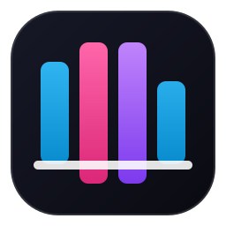
  <h1>OSU!Manager!</h1>
  <p>
    <strong>面向 osu!stable 与 osu!lazer 双端玩家的 osu!mania 谱面管理、免登录下载、3D 档案库与本地音乐台工作台</strong>
    <br />
    <sub>Cross-client osu!mania beatmap downloader, library manager, 3D Book Archive & Constructivist Music Station · 中文 / English UI</sub>
  </p>
  <p>
    <a href="https://github.com/LLLH73/OSU-Manager-/releases/latest">Releases 下载</a> ·
    <a href="#visual-showcase">界面预览</a> ·
    <a href="#简体中文">简体中文</a> ·
    <a href="#english">English</a> ·
    <a href="CHANGELOG.md">Changelog</a> ·
    <a href="docs/DEVLOG.md">Devlog</a>
  </p>
</div>

---

<a id="visual-showcase"></a>

## 界面预览 / Visual Showcase

<table>
  <tr>
    <td width="50%" valign="top">
      <a href="docs/screenshots/01-lazer-browse.png">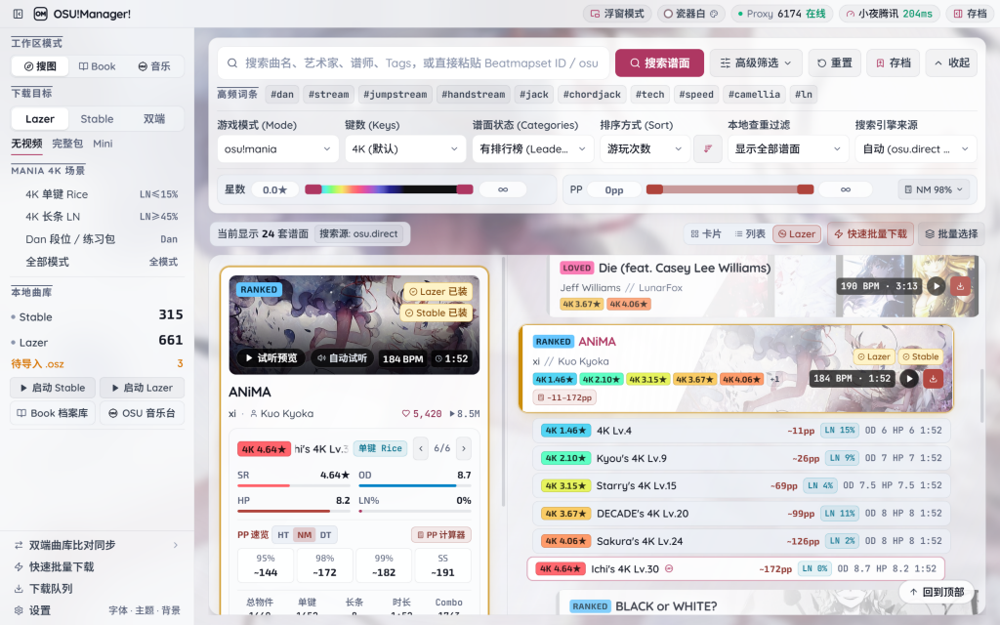</a>
      <br />
      <strong>01 · Lazer 选歌轮盘与动态背景 (Light · 瓷器白)</strong>
      <br />
      <sub>视口锁定弧形轮盘、本地已装金框标识、Ranked ~PP 与 Star/PP 双光谱滑块 / Lazer carousel, installed gold frames & Star/PP sliders</sub>
    </td>
    <td width="50%" valign="top">
      <a href="docs/screenshots/09-english-ui.png">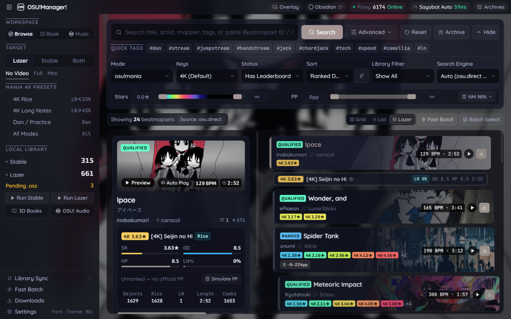</a>
      <br />
      <strong>02 · 全量英文界面 + Obsidian 暗色主题 (v1.11.0)</strong>
      <br />
      <sub>设置页一键热切「简体中文 / English」、动态显示本机代理端口与镜像测速 / Live ZH/EN toggle, Obsidian dark theme & dynamic proxy readout</sub>
    </td>
  </tr>
  <tr>
    <td width="50%" valign="top">
      <a href="docs/screenshots/02-detail-pp-calc.png">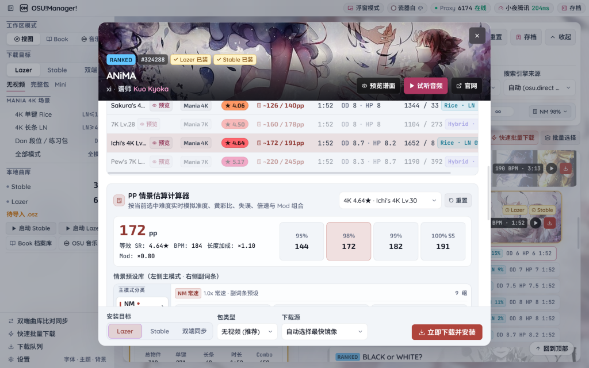</a>
      <br />
      <strong>03 · 谱面详情与交互式 PP 计算器</strong>
      <br />
      <sub>全难度表（星数 / LN% / 大致 PP）、支持 320:300 自定义黄彩比与变速情景推算 / Full diff table, MA ratio & custom Rate PP simulator</sub>
    </td>
    <td width="50%" valign="top">
      <a href="docs/screenshots/03-mania-preview.png">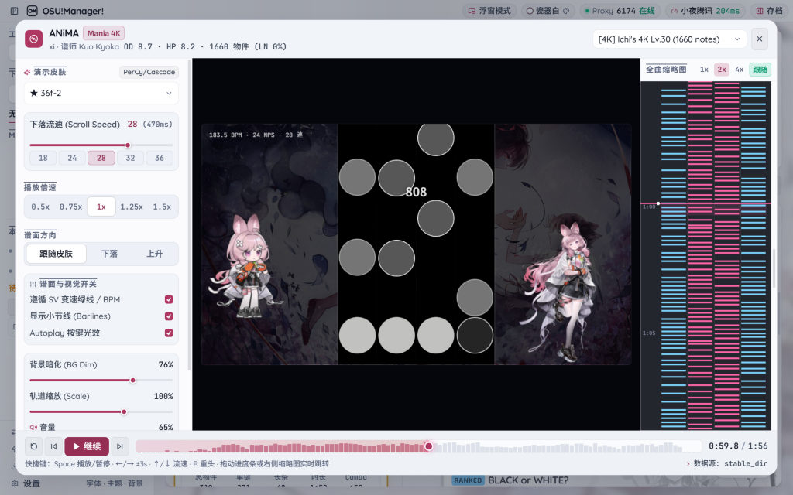</a>
      <br />
      <strong>04 · Mania 谱面实景预览器（兼容本地 PerCy 皮肤）</strong>
      <br />
      <sub>直读本地 <code>Skins/</code> 资源、SV/BPM 还原、NPS 密度条、倍速流速调节与缩略图导航 / Local skin rendering, SV timeline & minimap</sub>
    </td>
  </tr>
  <tr>
    <td width="50%" valign="top">
      <a href="docs/screenshots/04-book-3d-archive.png">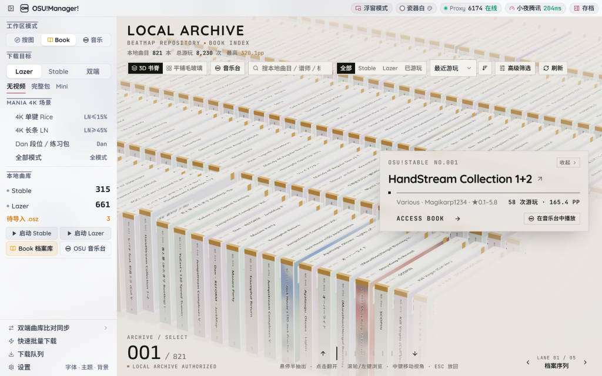</a>
      <br />
      <strong>05 · Book 模式 · Three.js 3D 书脊档案架</strong>
      <br />
      <sub>跨双端聚合本地 800+ 谱面、历史成绩与游玩统计，支持 3D 立体波浪抽出与双页详档 / 3D shelf uniting Stable + Lazer local collections</sub>
    </td>
    <td width="50%" valign="top">
      <a href="docs/screenshots/05-book-mosaic.png">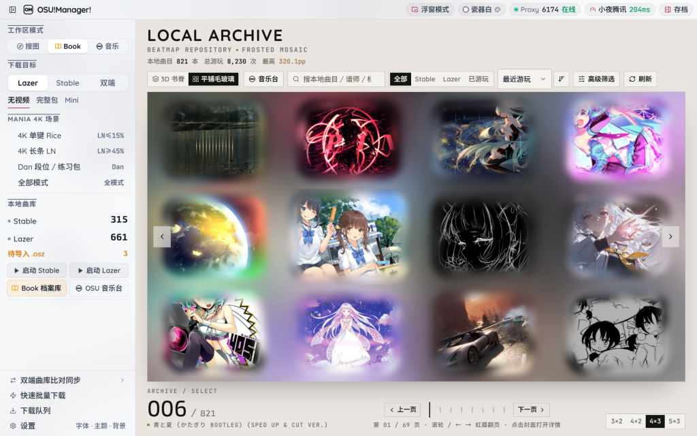</a>
      <br />
      <strong>06 · Book 模式 · 无字平铺毛玻璃光学窗</strong>
      <br />
      <sub>WebGL1 邻界混色背景模糊 + 悬停光学澄清水晶体与虹膜叠化翻页 / WebGL1 blurred optical mosaic & hover focus window</sub>
    </td>
  </tr>
  <tr>
    <td width="50%" valign="top">
      <a href="docs/screenshots/06-music-station.png">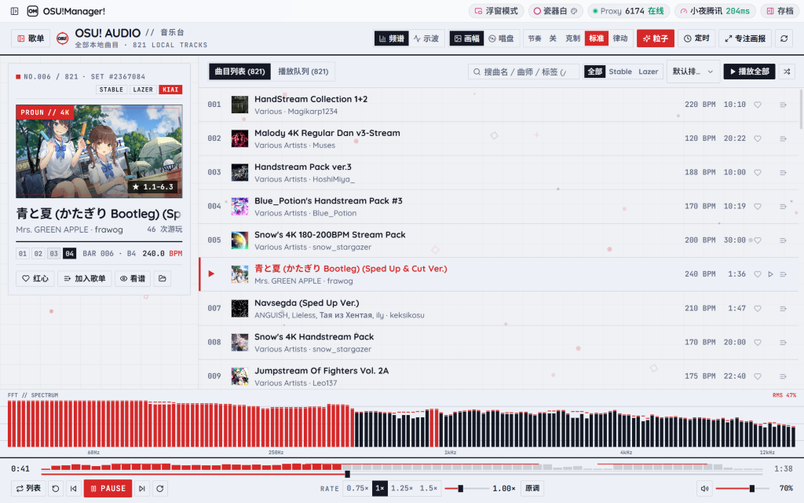</a>
      <br />
      <strong>07 · OSU! AUDIO // 构成主义本地音乐台</strong>
      <br />
      <sub>自动收起主侧栏、<code>STABLE / LAZER / KIAI</code> 徽标、红线节拍矩阵、FFT 频谱与 0.50×–2.00× 原调/NC 变调 / Spectrum deck, Kiai sync & playlists</sub>
    </td>
    <td width="50%" valign="top">
      <a href="docs/screenshots/07-music-zen.png">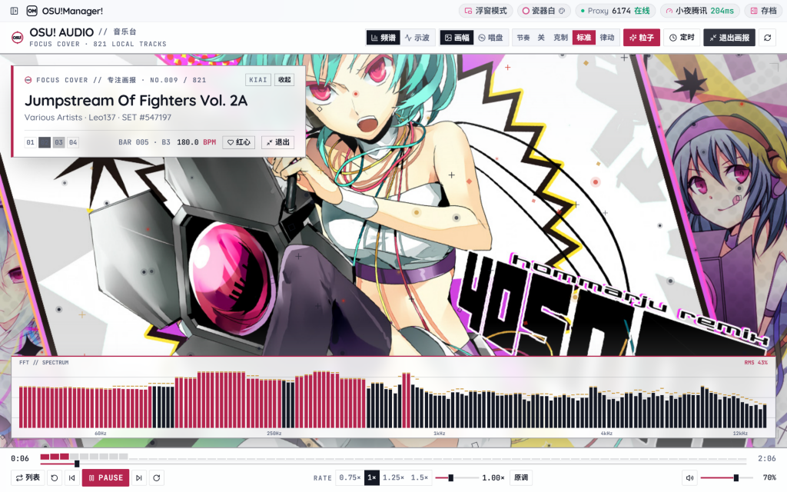</a>
      <br />
      <strong>08 · 音乐台「专注画报 (Focus Cover)」主题联动</strong>
      <br />
      <sub>全屏高清封面背景 + 动态主题取色适配 8 套明暗主题 + 底部宽幅实时可视化 / Full-bleed cover stage synced to active light/dark theme</sub>
    </td>
  </tr>
  <tr>
    <td width="50%" align="center" valign="top">
      <a href="docs/screenshots/08-onboarding-wizard.png">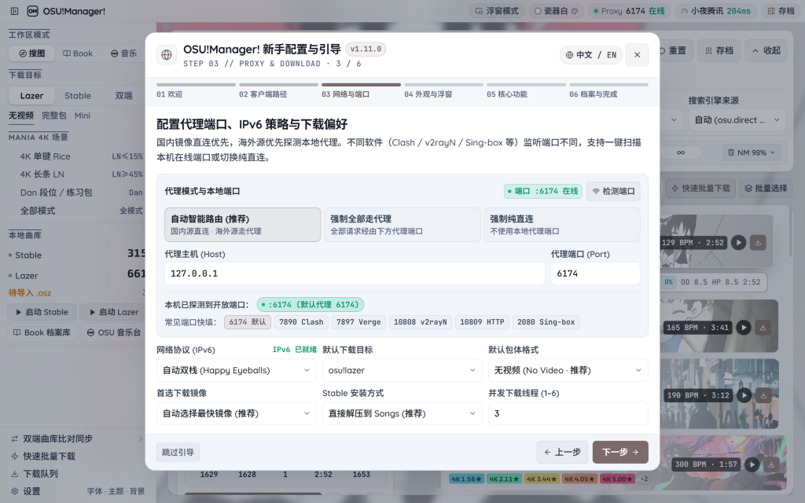</a>
      <br />
      <strong>09 · 跨电脑 6 步新手配置向导（支持一键探测稳定/Lazer 路径与本地代理端口）</strong>
      <br />
      <sub>Auto-detects Stable / Lazer folders &amp; online proxy ports (<code>6174</code> / Clash <code>7890</code> / v2rayN <code>10808</code>) on first launch</sub>
    </td>
    <td width="50%" align="center" valign="top">
      <a href="docs/screenshots/10-gacha-pack.png">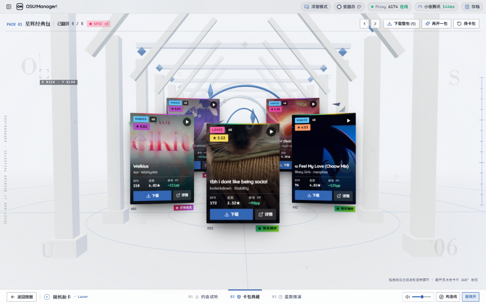</a>
      <br />
      <strong>10 · 随机抽卡 · 02 卡包典藏（纯 2D PROUN 平面构成 + 4K 下落轨道 + 高清 3D 圆环）</strong>
      <br />
      <sub>Pure 2D PROUN × osu!mania 4K poster stage (zero WebGL), HD covers &amp; Constructivist kinetic backs</sub>
    </td>
  </tr>
  <tr>
    <td width="50%" align="center" valign="top">
      <a href="docs/screenshots/11-gacha-dating.png">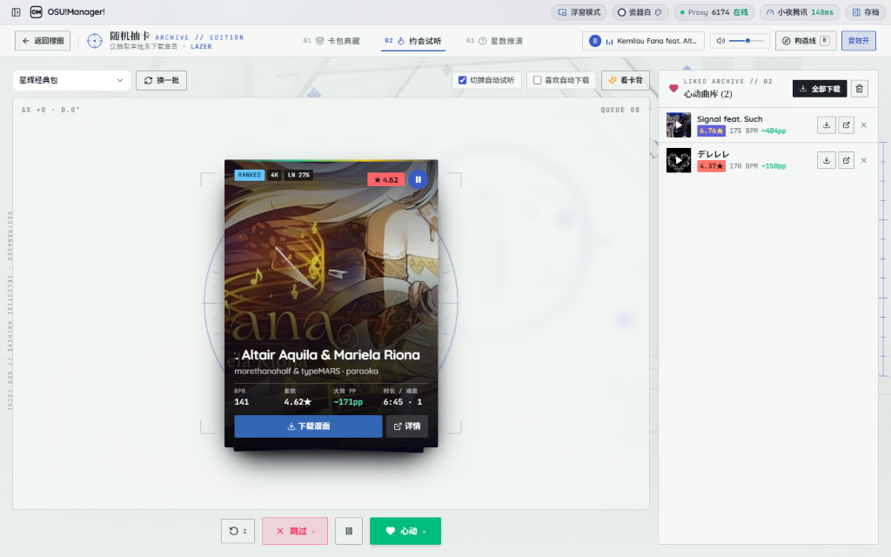</a>
      <br />
      <strong>11 · 随机抽卡 · 01 约会试听（默认模式 · 高清原画大图与多分组目标归档）</strong>
      <br />
      <sub>Default tab, HD fullsize artwork fanned right, direct group swipe targeting &amp; Constructivist foil backs</sub>
    </td>
    <td width="50%" align="center" valign="top">
      <a href="docs/screenshots/12-gacha-guess.png">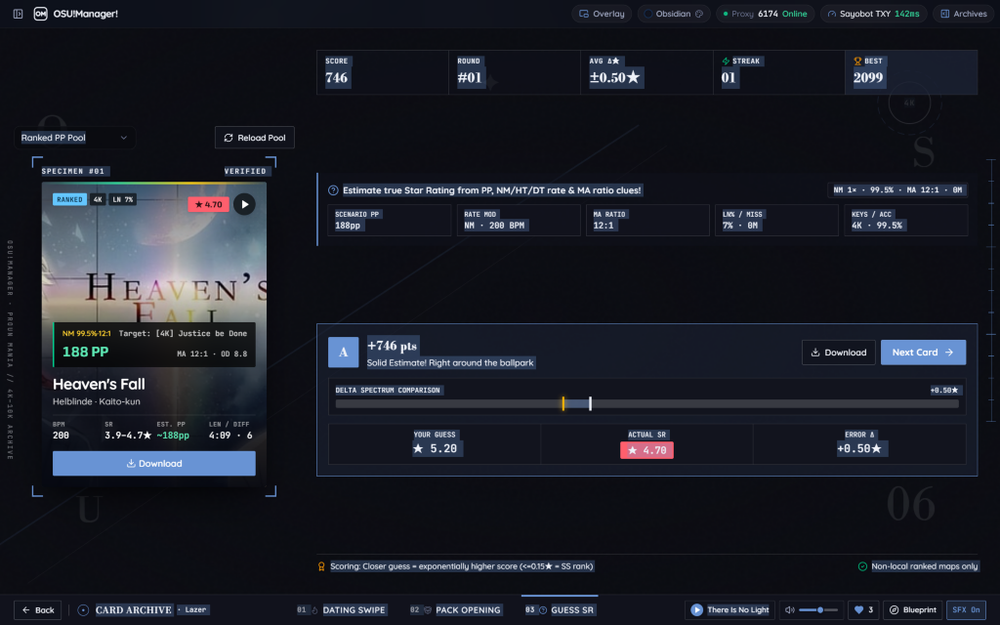</a>
      <br />
      <strong>12 · 随机抽卡 · 03 星数推演（曜石黑 · Hero PP 顶栏与八项独立情景要素 · 锁定详情）</strong>
      <br />
      <sub>Pure 2D PROUN backdrop, Details locked, Hero PP + 8-element Scenario Brief (Rate / Acc / MA / Miss / BPM / Keys·OD / LN% / Mods)</sub>
    </td>
  </tr>
  <tr>
    <td width="50%" align="center" valign="top">
      <a href="docs/screenshots/13-gacha-altar.png">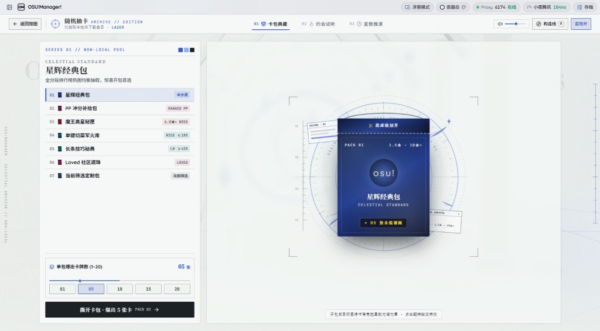</a>
      <br />
      <strong>13 · 随机抽卡 · 炉石风拖拽开包桌台与唤醒祭坛（物理握持惯性 + 磁吸高亮）</strong>
      <br />
      <sub>Hearthstone-style left reserve pack stack &amp; magnetically awakening Opening Altar drop well</sub>
    </td>
    <td width="50%" align="center" valign="top">
      <a href="docs/screenshots/14-gacha-inspector.png">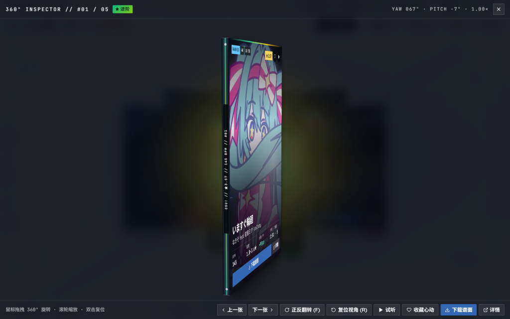</a>
      <br />
      <strong>14 · 随机抽卡 · 360° 3D 立体检视（20px 矢量金属铭文脊 + 真 3D Z 轴变焦 + 动态卡背）</strong>
      <br />
      <sub>360° Z-dolly zoom, crisp <code>20px</code> vector titanium spines, HD <code>fullsize.jpg</code> cover &amp; kinetic back</sub>
    </td>
  </tr>
</table>

---

<a id="简体中文"></a>

## 简体中文

### 项目介绍

**OSU!Manager!**（`osu-4k-dual-downloader`）是一款专为同时使用 **osu!stable** 与 **osu!lazer** 的 **osu!mania** 玩家打造的跨端桌面工具（默认 4K，支持 4K / 7K / 全键数切换与筛选，支持 Windows Electron 桌面端与本地 Web 服务）。

**无需登录 osu! 账号或填写 Cookie**，即可完成多镜像源搜图、试听、PP 情景筛选、Mania 谱面实景预览、1–500 首极速批量扫图、双端曲库零流量同步、游戏内磨砂浮窗搜图装图，并内置 **RhineLab 3D Book 本地曲库档案库** 与 **构成主义/瑞士风格 `OSU! AUDIO` 本地音乐台**。

### 功能介绍

1. **三视图搜图选歌（默认 Lazer 轮盘）与全窗动态背景**
   - **Lazer 选歌轮盘 (`lazer`)**：视口锁定双栏布局、rAF 二次曲线弧形偏移与淡出、平滑交错难度列表、`SR / OD / HP / LN%` 属性条、`HT / NM / DT` 快速 PP 速览，支持 `↑/↓`、`←/→`、`Space` 试听与 `Enter` 看详情。
   - **卡片 (`grid`) & 列表 (`list`) 视图**：支持多列封面网格与高密度紧凑列表，全视图滚底自动无限加载。
   - **动态封面背景与主题变色**：Lazer 模式下选中谱面自动切换全窗高透明封面并实时提取主色调联动界面强调色。

2. **Ranked 大致 PP 估算、情景筛选与 PP 计算器**
   - 所有列表与难度表直接显示 `ranked` / `approved` 谱面的大致 PP（`~XXXpp`）。
   - 筛选栏配备加粗 **Lazer 光谱星数双滑块（`0.0★–15.0★ / ∞`）** 与 **PP 范围双滑块（`0–2000pp / ∞`）**，以及主从分栏 **PP 情景库**（覆盖 `NM`、`DT 1.5x`、`HT 0.75x`、`变速 Rate` 与持久化 `自定义` 组合）。
   - 内置交互式 PP 计算器（对齐 `ppy/osu` `20241007` Mania 官方公式），支持调整准度（80%–100%）、Miss、倍速、**Lazer (`305` + LN 头尾双判) / Classic·Stable (`300` + LN 单判)** 同情景实时差异对比与 **自定义黄彩比（320:300）**，本地已安装 Mania 谱面还可直接读取 `.osu` 原谱精确计算 `HT / DT / 任意倍速` 星数（告别近似拟合）。

3. **双端曲库识别、零流量同步与极速批量下载**
   - 自动扫描 `osu!stable`（`Songs/`、`osu!.db`）与 `osu!lazer`（`client.realm` 只读二进制直读 + `files/`），本地已装谱面在任意视图自动点亮**四边金色框体**。
   - **双端零流量同步**：将 Stable 已有而 Lazer 缺少的谱面直接打包 `.osz` 导入 Lazer；客户端未启动时暂存至待导入队列支持一键批量导入。
   - **快速批量下载**：纯文本极简批下工作台，支持设定 `1–500` 首目标数、自动跨页跳过已装曲目、多镜像并发负载均衡（`1–12` 线程）与 IPv6/直连分流。
   - **一键拉起客户端**：左侧栏支持直接启动或唤起运行中的 Stable / Lazer 客户端。

4. **多镜像智能路由 & 本地代理探测**
   - 内置 7 大下载源与故障转移：`sayobot-auto`、`sayobot-txy`、`nekoha`、`osudirect`、`beatconnect`、`nerinyan`、`official`（完全可选 Cookie）。
   - 自动探测本地代理（默认 `127.0.0.1:6174`）与本机 IPv6 连通性，国内镜像直连优先、海外源代理优先，支持一键全源测速。

5. **Mania 谱面实景预览器**
   - 任意本地已安装 Mania 谱面均可直接预览：支持读取本地 `D:\OSU\Skins`（兼容 PerCy 超长 LN 皮肤）与内置皮肤、1–40 流速与倍速、上下落切换、可拖动 NPS 密度直方图与右侧缩略图条。

6. **Book 模式（RhineLab 3D 本地曲库档案库）**
   - 统一聚合 Stable 与 Lazer 本地曲目、历史成绩与游玩统计，提供 **3D 书脊档案架**（垂直波浪抽出、中键拖移视角、无缝循环与双页详情）与 **平铺毛玻璃视图**（柔和光学窗 + 虹膜叠化翻页），内置仿下载页高级筛选矩阵。

7. **OSU! AUDIO // 构成主义与瑞士风格本地音乐台**
   - **多入口与后台不间断播放**：可从左侧栏或 Book 模式进入（进入音乐台时自动收起主界面左侧栏，内置歌单栏默认收起）；切回搜图或 Book 模式后通过底部悬浮迷你条 `MusicMiniDock` 持续播放，Electron 下支持隐藏至系统托盘后台挂机与 Windows 媒体键控制。
   - **画幅 / 唱盘 & 实时可视化**：支持 `画幅 (PROUN)` 与无框 `唱盘 (DISC)` 双封面舞台、基于本地 `.osu` 红线/Kiai/密度解析的节拍矩阵、`0.50×–2.00×` 原调锁高 / Nightcore 磁带变调、自定义歌单持久化、可开关律动粒子、横贯全宽的 `频谱` / `示波` 双模式画布，以及**跟随全局 8 套主题配色切换的「专注画报」模式**。

8. **macOS 磨砂游戏内浮窗 & 8 套主题与跨机器新手配置向导**
   - 全局热键 `Alt+Shift+O`（可在设置修改）在无边框游戏中随时呼出亚克力毛玻璃浮窗搜图装图。
   - 内置 4 套暗色 + 4 套纸感浅色主题（默认「瓷器白」）、`85%–125%` 界面字号缩放（默认 `120%`）、离线 `@fontsource` Lazer 字体、Filter 右侧存档栏，以及**首次启动 6 步交互式配置与引导向导**（支持自动扫描不同电脑盘符下的 `osu!stable` / `osu!lazer` 路径与 `storage.ini`，探测 Clash/v2rayN/Sing-box 等本机在线代理端口、设置 IPv6 与下载偏好、实时预览主题字号并保存至配置，之后可在「设置 → 关于与帮助」随时重看）。

9. **全量简体中文 / English 双语切换与动态代理测速**
   - 覆盖搜图选歌、详情/PP 计算器、Mania 预览器、3D Book 档案库、OSU! 音乐台、游戏内浮窗、Electron 系统托盘菜单与后端错误/镜像描述的全量中英双语体验。
   - 可在「设置 → 分区 3」或新手引导右上角切换 `简体中文` / `English`（切换立即预览，点保存持久化至 `config.json`，取消/Esc 自动回滚）；右上角测速状态与提示文案严格跟随用户实际配置的 `proxyPort`（不再固定写死 `6174`）与直连/代理模式动态显示。

10. **随机抽卡工作室（`v1.16.1` — 纯 2D PROUN 平面构成舞台 · 炉石拖拽开包 · 原画高清封面 · 极简八要素猜星台）**
   - 在浏览模式 `Lazer` 按钮右侧提供「随机抽卡」入口，打开后**自动收起主左侧栏与存档栏**；模式切换栏下移至纤细的**底部导航 Dock**，**默认直接进入 `01 约会试听`**（顺序为 `01 约会试听 · 02 卡包典藏 · 03 星数推演`）。
   - **纯 2D PROUN × osu!mania 4K 平面构成背景（零 WebGL 开销）**：以高精度 SVG 构成主义海报几何与远边距双侧 `osu!mania` 4K 动态下落音符带替代 3D 模型渲染，随约会 / 卡包 / 推演三模式与全局主题切换构图（`B` 键切换平面辅助构造线），兼顾视觉锐度与轻量化性能。
   - **动态构成主义 × osu! 动效卡背（全新替换）**：告别星空样式，采用融合全局主题 `--t-osu` 的深炭金属 Foil 质感卡背，集成包豪斯斜切角、流光扫掠（Specular Foil Sweep）、双侧实时滚动的 `osu!mania` 4K 窄轨音符条以及中央双圈旋动游标尺 + 呼吸缩圈 `osu!` Approach Ring。
   - **炉石传说风拖拽开包 + 秒开预取 + 高清卡片 & 20px 矢量金属脊**：左侧卡包叠放可按住拖拽并随速度产生 3D 倾斜，拖向右侧「Opening Altar」祭坛时逐级点亮光晕与瞄准锁框，松手磁吸炸开 3D 圆环（拖出松手平滑回弹，亦可点击或拉动顶部虚线封条）；卡片封面通过 `/api/media/cover/:id?hd=1` 代理缓存 `fullsize.jpg` 原画大图，10 张紧凑圆环悬停单行显示「点击 360° 检视」，配合 360° 立体检视器的真 3D `translateZ` 推进变焦与 `20px` 高精度 `<svg>` 钛金属雕刻侧脊（含纵向 `OSU! // ★SR // BPM // #serial`），彻底消除放大糊边。
   - **多分组持久心动曲库与 `07 条件自选池`**：全模式收藏持久保存至 `data/gacha-collections.json`，支持新建/重命名/清空/删除分组、单曲多分组勾选分配、按组批量下载及约会顶部目标组直选；`07 条件自选池` 配备独立弹窗支持自主配池、同步主搜图条件与导入 Filter 存档。
   - **03 星数推演**：移除卡片 `详情` 入口严格防止窥见真实星数，采用与 2D 舞台通透融合的极简 Hero PP 顶栏与 **4×2 八项独立情景要素网格**（速率倍率 / 目标准度 / 黄彩比 / 失误数 / 等效 BPM / 键数与判定 / 长条占比 / 计分与 Mod），提供 24 种严格基于 `NM (1.0x)` / `HT (0.75x)` / `DT (1.5x)` 倍率的实景推演。

### 快速开始

#### 1. 从 GitHub Releases 直接下载（推荐）

前往 👉 **[GitHub Releases 最新版本](https://github.com/LLLH73/OSU-Manager-/releases/latest)**（或 [查看全部历史版本](https://github.com/LLLH73/OSU-Manager-/releases)），按需选择以下任一 Windows 发行包：

- **安装版 Setup（`osu-manager-1.10.0-setup.exe`）**：标准 Windows 安装向导，支持自定义安装路径，并自动创建桌面与开始菜单快捷方式；
- **单文件便携版（`osu-manager-1.10.0-portable.exe`）**：单文件免安装可执行程序，下载后双击即可运行；
- **绿色免安装压缩包（`osu-manager-1.10.0-win-x64.zip`）**：解压后直接运行其中的 `osu-manager.exe`，无自解压开销、启动最快。

> **本地源码目录与首次引导提示**：如果你已拉取并构建本地仓库，也可以直接运行 `release\win-unpacked\osu-manager.exe` 或双击根目录 [start-desktop.bat](start-desktop.bat) / [start.bat](start.bat)。首次启动会自动弹出 **6 步新手配置向导**，自动探测本机 `osu!stable` / `osu!lazer` 安装路径与在线代理端口（如 `6174` / `7890` / `7897` / `10808` 等，也可随时选择纯直连或手动浏览修改）；全部配置均可随时在左下角「设置」中微调，并在「关于与帮助」查看版本号或重新观看新手引导。

#### 2. 源码开发与构建打包

```bash
# 安装依赖
npm install

# 启动前后端并行开发模式（API :3721 + Vite :5173）
npm run dev

# 全量 TypeScript 类型检查（Web / Server / Electron）
npm run typecheck

# 构建生产产物（dist/ + dist-server/ + dist-electron/）
npm run build

# 启动本地 Electron 开发窗口
npm run electron

# 打包 Windows 免安装目录版并自动嵌入 OM 图标 -> release/win-unpacked/osu-manager.exe
npm run electron:pack

# 一次性构建完整 Release 发行包（win-unpacked/osu-manager.exe + win-x64.zip + portable.exe + setup.exe）
npm run electron:dist
```

> **数据目录说明**：打包运行态下配置、歌单与筛选存档默认存储在 `%APPDATA%\osu-4k-dual-downloader\data`（可通过环境变量 `OSU_DL_DATA_DIR` 自定义）；源码开发态下默认存储在工作区 `./data`（已被 `.gitignore` 忽略，不会上传至 Git）。

---

<a id="english"></a>

## English

### Overview

**OSU!Manager!** (`osu-4k-dual-downloader`) is a cross-client desktop companion built for **osu!mania** players (defaults to 4K, with full 4K / 7K / all-key filtering & preview support) who use both **osu!stable** and **osu!lazer**.

No osu! login or session cookie is required. It brings together multi-mirror beatmap search, audio previewing, scenario-aware Ranked PP filtering, a skin-accurate Mania chart previewer, high-concurrency batch downloading, zero-traffic Stable-to-Lazer library sync, an acrylic in-game overlay, a **3D Book Archive** for your local collection, and a **Constructivist / Swiss-style local Music Station**.

### Key Features

- **3 Browse Layouts (Lazer Carousel Default) & Dynamic Backgrounds**
  - **Lazer Song Select (`lazer`)**: Viewport-locked split layout with rAF-driven curved carousel, staggered difficulty rows, `SR / OD / HP / LN%` bars, quick `HT / NM / DT` PP readout, full keyboard navigation (`↑/↓`, `←/→`, `Space`, `Enter`), and full-window cover-art theming.
  - **Grid (`grid`) & List (`list`) Views**: Dense card/list browsing with infinite scroll loading and gold borders on locally installed beatmaps.
- **Ranked PP Estimation, Scenario Presets & PP Calculator**
  - Dual-thumb spectral Star Rating (`0.0★–15.0★ / ∞`) and PP (`0–2000pp / ∞`) sliders plus master-detail scenario presets (`NM`, `DT 1.5x`, `HT 0.75x`, custom `Rate`, and saved presets), **official `ppy/osu` (`20241007`) Mania PP math**, live **`Lazer (305 + LN head/tail)` vs `Classic/Stable (300 + 1× LN)`** side-by-side comparison, exact local `.osu` HT/DT/custom-rate Star Rating calculation, and a custom `320:300` MA ratio simulator.
- **Dual-Client Recognition, Zero-Traffic Sync & Fast Batch**
  - Scans both `osu!stable` (`Songs/`, `osu!.db`) and `osu!lazer` (zero-native-dep read-only `client.realm` + `files/`).
  - Sync maps missing in Lazer directly from Stable without re-downloading, launch/focus either game client from the sidebar, and run `1–500` map text-only Fast Batch downloads across 7 mirrors with IPv6 / proxy (`127.0.0.1:6174` default) smart routing.
- **Mania Chart Previewer**
  - Canvas2D 4K–10K playfield with real local `Skins/` support (including PerCy long-LN cropping), scroll speed `1–40`, playback rate, upscroll/downscroll, draggable NPS density timeline, and zoomed overview rail.
- **Book Mode (`RhineLab` 3D Shelf & Frosted Mosaic)**
  - Aggregates local beatmaps and scores across both clients into an interactive Three.js 3D spine shelf and a frosted-glass mosaic view with multi-dimensional filtering and two-page spread details.
- **OSU! AUDIO // Constructivist Music Station**
  - Persistent background audio engine with `MusicMiniDock` and Electron tray playback controls; auto-collapses the main sidebar upon entering while keeping its own playlist rail collapsed by default.
  - Poster (`PROUN`) & frameless Turntable (`DISC`) stages with responsive `STABLE`/`LAZER`/`KIAI` badges, `.osu` red-line beat matrix, `0.50×–2.00×` pitch-locked or Nightcore playback, custom playlists, toggleable reactive particles, full-width `Spectrum / Oscilloscope` visualizers, and a **theme-synced Focus Cover (Zen) mode** across all 8 light & dark themes.
- **Acrylic In-Game Overlay, 8 Themes & Cross-PC Setup Onboarding**
  - Global shortcut `Alt+Shift+O` toggles a compact acrylic overlay above borderless osu! windows.
  - Includes 4 dark + 4 light themes (default `light`), UI font scaling (`85%–125%`, default `120%`), Filter Archives right rail, and an interactive **6-step first-run setup & onboarding wizard** that auto-detects `osu!stable` / `osu!lazer` directories (including `storage.ini`) and open local proxy ports (`6174`, Clash `7890/7897`, v2rayN `10808/10809`, Sing-box `2080`, etc.), configures IPv6/download/theme preferences, and can be replayed anytime from **Settings → About & Help**.
- **Full ZH / EN Bilingual Switcher & Dynamic Proxy Diagnostics**
  - Complete Simplified Chinese & English localization across Browse, Beatmap Detail & PP Calculator, Mania Previewer, 3D Book Archive, OSU! AUDIO Music Station, Acrylic Overlay, Electron Tray/Hotkeys, and backend mirror/status responses.
  - Switch live via **Settings → Section 3 (`简体中文 | English`)** or the onboarding header pill (persisted in `config.json`, safely rolls back on Cancel/Esc). Top-bar latency checks and toast notifications dynamically reflect your configured `proxyPort` or `Direct` mode.
- **Random Card Draw Studio (`v1.16.1` — Pure 2D PROUN Graphic Stage, Hearthstone Drag-to-Altar, HD Covers & Minimalist 8-Element Guess Console)**
  - Accessible beside the `Lazer` view button in Browse mode; **automatically collapses both sidebars** on launch and exclusively draws non-local beatmapsets through clean numbered card pools (`01 All-Pool Mix` – `07 Custom Filter Pool`) and tier labels (`Standard` – `Apex 8★+`).
  - **Zero-WebGL 2D Flat PROUN × osu!mania Stage**: Replaces Three.js 3D meshes with a crisp flat vector editorial backdrop plus far-margin 2D `osu!mania` 4K scrolling rhythm lanes (adapting per tab and `B` blueprint mode) for sharper lines and minimal GPU overhead.
  - **Dynamic Constructivist × osu! Kinetic Card Back**: Replaces starry backdrops with a theme-infused (`--t-osu`) dark foil plate featuring Bauhaus diagonal cuts, drifting metallic sheen, twin live-scrolling 4K margin strips, counter-rotating vernier calipers, and a rhythmic contracting `osu!` Approach Ring.
  - **Hearthstone Draggable Pack Table, HD Artwork & 20px Vector Spines**: Grab booster packs from a physical left reserve stack with velocity-driven 3D banking and drop them into a magnetically awakening right **Opening Altar** (outside drops smoothly spring back; tear seam drag & direct clicks remain supported). Cards fetch full-res `fullsize.jpg` covers via `/api/media/cover/:id?hd=1` with a crisp single-line `360° INSPECT` hover badge even in compact 10-card rings, while the **360° Inspector** switches to true-3D `translateZ` zoom and razor-sharp **`20px` vector `<svg>` engraved titanium spines** (`OSU! // ★SR // BPM // #serial`), alongside `data/gacha-collections.json` multi-group favorites & the Pool `07` Custom Filter Modal.
  - **03 Guess SR**: Keeps `Details` locked so stars stay hidden, pairing a translucent Hero PP header with a **4×2 grid of 8 independent scenario elements** (Rate, Accuracy, MA Ratio, Miss, Effective BPM, Keys & OD, LN%, Mods) across 24 `NM (1.0x)` / `HT (0.75x)` / `DT (1.5x)` challenges harmonized with the 2D graphic canvas.

### Quick Start

#### Option 1: Download from GitHub Releases (Recommended)

Visit 👉 **[GitHub Releases (Latest)](https://github.com/LLLH73/OSU-Manager-/releases/latest)** (or [browse all releases](https://github.com/LLLH73/OSU-Manager-/releases)) and pick the Windows package you prefer:

- **Installer Setup (`osu-manager-1.10.0-setup.exe`)**: Standard NSIS Windows installer with custom directory selection and Desktop / Start Menu shortcuts.
- **Single-File Portable (`osu-manager-1.10.0-portable.exe`)**: Self-contained single executable with zero installation required.
- **Portable ZIP Archive (`osu-manager-1.10.0-win-x64.zip`)**: Extract anywhere and launch `osu-manager.exe` with zero self-extraction overhead.

> If you are running from a local build, launch `release\win-unpacked\osu-manager.exe`, `start-desktop.bat`, or `start.bat`.

#### Option 2: Build from Source

```bash
# 1. Install dependencies
npm install

# 2. Run API (:3721) + Vite (:5173) in dev mode
npm run dev

# 3. Type-check Web, Server, and Electron targets
npm run typecheck

# 4. Build production bundles (dist/, dist-server/, dist-electron/)
npm run build

# 5. Launch Electron desktop app locally
npm run electron

# 6. Package portable Windows directory + embed OM icon -> release/win-unpacked/osu-manager.exe
npm run electron:pack

# 7. Build all Windows release artifacts (win-unpacked/osu-manager.exe, win-x64.zip, portable.exe, setup.exe)
npm run electron:dist
```

> Under packaged builds, app config and playlists default to `%APPDATA%\osu-4k-dual-downloader\data` (override via `OSU_DL_DATA_DIR`).

---

## 目录结构 / Directory Layout

```text
OSU-Manager-/
├── AGENT.md                  # AI 助手快速接手指南 / AI assistant guide
├── CHANGELOG.md              # 版本变更日志 / Release changelog
├── README.md                 # 中英文双语说明文档 / Bilingual README
├── docs/
│   ├── DEVLOG.md             # 按会话记录的开发日志 / Session-by-session devlog
│   └── screenshots/          # README 展示截图 / UI showcase screenshots (01–13)
├── build/                    # OM 矢量与多分辨率应用图标 (icon.svg / icon.png / icon.ico)
├── scripts/                  # 打包后 PE 图标注入 (apply-exe-icon.mjs) 与 GitHub Release 发布脚本 (publish-github-release.mjs)
├── electron/                 # Electron 主进程与 preload 桥接
├── server/                   # Express v5 后端（搜索、镜像路由、Realm 读取、下载队列、本地曲库/歌单）
├── src/                      # React 19 + Vite 6 + Tailwind CSS v4 前端（含 book/、gacha/ 与 music/ 模块）
├── package.json              # 脚本与 Electron Builder 配置
├── start-desktop.bat         # 桌面版快捷启动脚本
└── start.bat                 # 通用启动脚本
```

## 相关文档 / Documentation

- **AI 接手手册 / Agent Guide**: [AGENT.md](AGENT.md)
- **开发日志 / Development Log**: [docs/DEVLOG.md](docs/DEVLOG.md)
- **更新日志 / Changelog**: [CHANGELOG.md](CHANGELOG.md)
